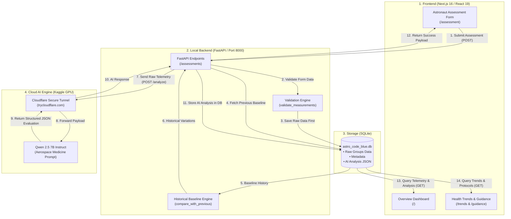

# ASTRO CODE BLUE — System Architecture & Data Flow

ASTRO CODE BLUE is an astronaut health telemetry and clinical countermeasure system designed for human spaceflight missions. It combines self-reported wellness, medical diagnostic readings, and environmental telemetry with local SQLite persistence and deep clinical inference powered by a GPU-accelerated Qwen 2.5 7B AI model.

---

## 1. High-Level Architecture Flowchart



---

## 2. End-to-End Data Pipeline

### Step 1: Data Collection (How Collected Data is Obtained)
Astronaut data is gathered through the **Health Self-Assessment Console** (`app/components/health-assessment-form.tsx`) across six mission domains:

1. **Sleep & Daily Wellness**: Sleep duration (hours), sleep quality rating (1–5), disturbances, bedtime, exercise duration (mins), exercise type (aerobic/resistance), hydration/water intake (L), and fatigue rating (1–5).
2. **Mental & Cognitive Health**: Subjective mood rating (1–5), stress level (1–5), concentration difficulty, isolation/distress flags, and WinSCAT cognitive battery results (reaction time, visual/verbal working memory).
3. **Vision & Symptoms (SANS)**: Near-vision changes, blurred/distorted vision, visual acuity test results, Amsler grid findings, and self-reported symptoms (headaches, dizziness, nausea, lightheadedness).
4. **Vital Signs & Physical Health**: Heart rate (BPM), systolic & diastolic blood pressure (mmHg), oxygen saturation (`SpO2` %), body temperature (°C), respiratory rate, and muscle fatigue notes.
5. **Space Environment**: Cabin CO₂ partial pressure (mmHg), cabin temperature (°C), pressure (kPa), humidity (%), and radiation dosimeter readings (mSv and mSv/day).
6. **Specialized Medical Measurements**: DXA bone mineral density scans, bone turnover markers, vitamin D, optic ultrasound / OCT results, internal jugular vein ultrasound, and immune markers.

Each field records its **numerical value or observation**, **measurement unit**, **ISO timestamp**, **data source** (`device`, `manual_entry`, `self_reported`, `medical_test`, or `imported`), and **optional clinical notes**.

---

### Step 2: Backend Validation & Raw Data Storage (How Data is Stored)
When the astronaut clicks **`SUBMIT →`**:

1. **Schema Validation**: The FastAPI backend (`backend/main.py`) validates that all entered measurements are finite numbers and contain valid units (`validate_measurements()` in `backend/health_analysis.py`).
2. **Raw Data Stored First**: The raw inputs are immediately committed to the SQLite database (`backend/astro_code_blue.db`) under the `assessments` table:
   - `id`: Unique UUID.
   - `assessmentDate`: Date of observation.
   - `submittedAt`: Server ingestion timestamp.
   - `groups`: **Full, uncompressed, untouched raw measurement dictionary**.
   - `assessmentNotes`: Astronaut's observational text.
3. **Comparative Analysis**: The system retrieves the immediately preceding assessment from SQLite and calculates historical deltas (`compare_with_previous()`) for vital signs, hydration, and sleep duration.

---

### Step 3: AI Transmission (How Data is Sent to AI)
Once raw data is safe in SQLite, the backend dispatches an asynchronous request to the external AI Engine (`backend/kaggle_ai.py`):

1. **Payload Packaging**: The raw assessment dictionary is serialized into a JSON object:
   ```json
   { "raw_assessment": { ...groups, assessmentNotes, submittedAt } }
   ```
2. **Secure Routing**: The request is routed via HTTPS over a **Cloudflare Tunnel** (`https://<active-tunnel>.trycloudflare.com/analyze`) directly into the Kaggle GPU container.
3. **Clinical Role Prompting**: The Qwen 2.5 7B Instruct model receives a system prompt acting as a NASA Flight Surgeon assistant, analyzing microgravity physiological risks:
   - Spaceflight Associated Neuro-ocular Syndrome (SANS)
   - Cardiovascular deconditioning & orthostatic intolerance
   - Bone mineral density loss & muscle atrophy
   - Cabin atmospheric hazards (hypercapnia from CO₂ buildup)
   - Circadian rhythm disruption and sleep deficits

---

### Step 4: AI Inference & Data Acquisition (How AI Data is Obtained)
The Qwen model generates a strict, structured JSON object:

```json
{
  "overall_health_status": "Nominal" | "Caution" | "Critical",
  "overall_summary": "Crew member shows stable cardiovascular telemetry with mild cumulative sleep debt...",
  "medical_alert": {
    "severity": "low" | "moderate" | "high" | "critical",
    "seek_medical_support": true | false,
    "advice": "Flight surgeon consult recommended if vision changes persist beyond 48 hours."
  },
  "section_statuses": {
    "sleepAndWellness": { "status": "Caution", "findings": "Sleep duration 5.5h is below nominal target." },
    "vitalSigns": { "status": "Nominal", "findings": "Resting heart rate and blood pressure within target limits." },
    "cognitiveHealth": { "status": "Nominal", "findings": "High morale and low stress ratings." },
    "visionAndSymptoms": { "status": "Nominal", "findings": "No SANS visual symptoms reported." },
    "spaceEnvironment": { "status": "Nominal", "findings": "Cabin CO2 at 2.8 mmHg within allowable limit." },
    "specializedMedical": { "status": "Nominal", "findings": "No acute biomarkers flagged." }
  },
  "exercises": [
    { "name": "ARED Heavy Resistance Protocol", "duration": "45 mins", "purpose": "Mitigate bone density loss and axial skeleton unloading." },
    { "name": "T2 Treadmill Interval Loading", "duration": "30 mins", "purpose": "Cardiorespiratory maintenance and leg muscle perfusion." }
  ],
  "healthcare_suggestions": [
    "Increase daily water intake to 2.6 L to counteract mild hemoconcentration.",
    "Shift sleep hygiene lighting spectrum 45 minutes prior to scheduled sleep cycle."
  ]
}
```

The backend parses this JSON and commits it directly into the `analysis` column of the SQLite assessment row.

---

### Step 5: Where and How All Data is Used Across the Application

| Application Section | Source Data Used | Visual & Functional Behavior |
| :--- | :--- | :--- |
| **Crew Profile Panel** (`/`) | `analysis.overall_health_status`, `submittedAt` | Displays astronaut ID, mission day, timestamp of last assessment, and an **intelligent status badge**: glowing Green for `NOMINAL`, Yellow for `CAUTION`, and Red for `CRITICAL`. |
| **Health Level Panel** (`/`) | `groups.vitalSigns` (Heart Rate, BP, SpO₂, Temp) | Displays vital readings and calculated overall health score. In empty DB state, displays `"—"` and direct `+ Add Vitals` shortcut. |
| **Sleep Analytics Panel** (`/`) | `groups.sleepAndWellness` (Sleep hours, water intake) | Visualizes recorded sleep hours against 8h target. If empty, displays an interactive empty-state graphic with direct redirect to the sleep section. |
| **Vital Signs Trend Cards** (`/`) | `groups.vitalSigns` & `groups.sleepAndWellness` | • **Heart Rate & BP**: Multi-point historical trend line chart with systolic/diastolic dual curves.<br/>• **Oxygen Saturation**: Circular SVG slice chart displaying percentage share.<br/>• **Hydration**: Stylized fluid reservoir SVG showing volume in Liters. |
| **Health Insights Panel** (`/`) | `analysis.medical_alert`, `analysis.exercises`, `analysis.healthcare_suggestions`, `assessmentNotes` | • **Medical Alert Box**: High-visibility clinical banner warning if Flight Surgeon consultation is recommended with severity level.<br/>• **Prescribed Exercises**: Countermeasure cards detailing exercise name, duration, and clinical purpose.<br/>• **Physiological Suggestions**: Operational healthcare recommendations.<br/>• **Raw Notes**: Display of astronaut observations. |
| **Assessment Form** (`/assessment`) | SQLite `assessments` count & index number | Top status bar displays live database count: `${records.length} SAVED RECORD(S) IN DB · INDEX #${records.length}`. |
| **Section Deep Linking** | URL parameters (e.g. `?section=vitalSigns`) | Overview redirect buttons automatically expand the target accordion section and smoothly scroll it into view. |

---

## 3. Running the Complete System

### 1. Start the Local Backend
```powershell
cd backend
python -m uvicorn main:app --reload --port 8000
```
*API will be active at `http://127.0.0.1:8000` with database stored at `backend/astro_code_blue.db`.*

### 2. Start the AI Model on Kaggle
1. Open your Kaggle Notebook with **GPU T4 x 2** enabled and **Internet on**.
2. Run the notebook cell to load Qwen 2.5 7B and initialize the Cloudflare tunnel.
3. If the tunnel URL changes, update `KAGGLE_AI_URL` in `backend/kaggle_ai.py` or run:
   ```powershell
   Invoke-RestMethod -Uri "http://127.0.0.1:8000/api/set-kaggle-url" -Method Post -ContentType "application/json" -Body '{"url":"https://your-tunnel.trycloudflare.com"}'
   ```

### 3. Start the Frontend
```powershell
npm run dev
```
*Open `http://localhost:3000` to interact with the dashboard.*
# astro_code

# astro-code

